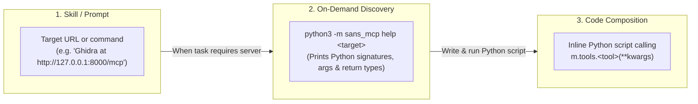
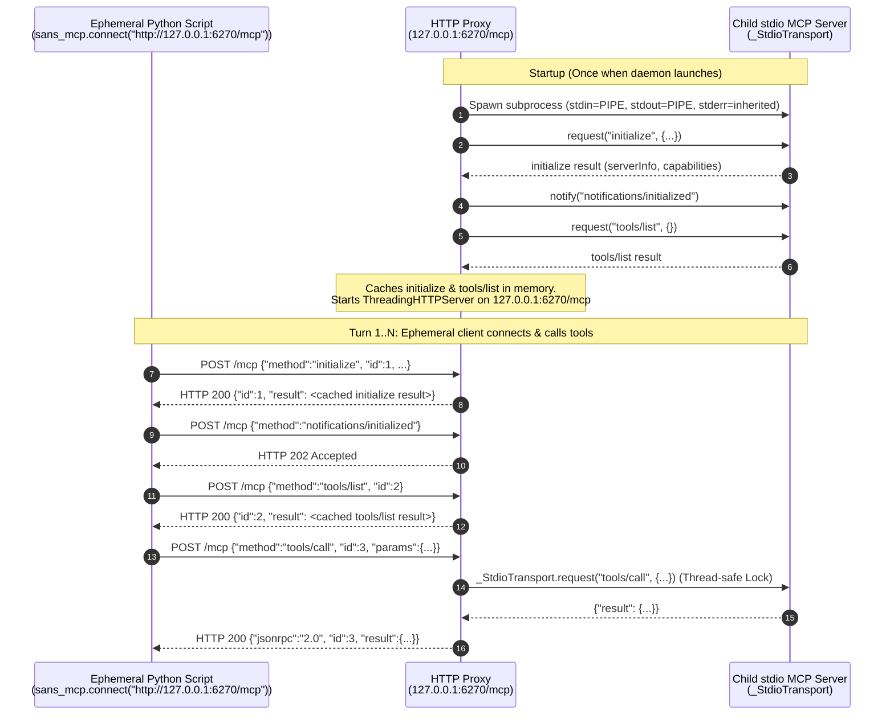

# `sans-mcp` Architecture

`sans-mcp` is a Python library and CLI tool that lets LLM coding agents access Model Context Protocol (MCP) servers through ad-hoc Python scripts. The agent harness does not need built-in MCP support or MCP server configuration. The agent only needs to run shell commands and Python.

## 1. Motivation

Standard MCP integrations in LLM clients have three limitations:

1. **Upfront Context Usage:**
   When an agent session starts, standard MCP clients fetch `tools/list` from every configured MCP server and inject all JSON Schemas into the system prompt. Connecting multiple MCP servers adds thousands of schema tokens to every turn, even when most tools are unused.
2. **Multi-Turn Tool Calls vs. Code Composition:**
   When an agent inspects a list of items, filters them, and fetches details for matches via standard MCP tool calls, each step requires an LLM round-trip and appends intermediate payloads to the conversation history.
3. **Harness MCP Support and Configuration:**
   Standard MCP requires the agent harness to support the protocol, manage server lifecycles, and load harness-specific configuration files before a session starts. With `sans-mcp`, any agent capable of running Bash and Python can use MCP servers directly through ad-hoc scripts without harness configuration.

### How `sans-mcp` Works

Instead of registering MCP servers with the LLM harness, the agent uses Bash and Python to discover and call tools on demand:



- **On-demand schema lookup:** The agent fetches tool schemas only when a task requires a specific MCP server.
- **Compact Python signatures:** `python3 -m sans_mcp help <target>` formats server tools into Python function signatures with parameter descriptions and return types.
- **In-memory data processing:** The agent writes short Python scripts to loop, filter, paginate, and process intermediate results in memory, printing only the final output to the context window.
- **Synchronous API:** Wraps JSON-RPC handshakes, SSE parsing, and MCP content envelopes in a synchronous Python interface.

## 2. Design Principles

1. **Single-File, Pure Python Standard Library:**
   All library and CLI code lives in `sans_mcp.py` using only Python standard library modules (`argparse`, `atexit`, `contextlib`, `dataclasses`, `http.server`, `itertools`, `json`, `keyword`, `os`, `queue`, `re`, `shlex`, `signal`, `subprocess`, `sys`, `threading`, `typing`, `urllib`, `uuid`).
   - **Why single-file:** LLM agents frequently run `python3 -c "import sans_mcp; ..."` or standalone scripts from arbitrary directories. A single file with zero external dependencies can be copied directly into any workspace or installed globally.
   - **Why `proxy` lives in the same file:** The proxy wraps `_StdioTransport` with `ThreadingHTTPServer`. Keeping it in `sans_mcp.py` avoids duplicating transport code and provides a single executable for both discovery (`help`) and persistent background hosting (`proxy`).
2. **Synchronous Client API:**
   Designed for `python3 -c "..."` one-liners and standalone scripts without requiring `async`/`await` or `asyncio.run()`.
3. **Minimal Public API Surface:**
   - Public exports are restricted via `__all__` to `SansMCP`, `SansMCPError`, `connect`, and `main`.
   - Internal functions and classes are prefixed with `_`.
   - Public signatures are tracked in `etc/api_surface.txt` and enforced by `tests/test_api_surface.py`.
   - One way to discover tools: `python3 -m sans_mcp help <target> [<tool_name>]` (or `m.help()`).
   - One way to call tools: `m.tools.<tool_name>(**kwargs)` using Python keyword arguments.
4. **Deterministic Python Identifier Normalization:**
   MCP tool names and top-level parameter names are normalized into valid, unique ASCII Python identifiers backed by the server's `tools/list` schema, and mapped back to their wire names on invocation.
5. **Namespace Separation (`m.tools`):**
   Client lifecycle and introspection methods live on `SansMCP` (`m.help()`, `m.close()`), while MCP tools live under `m.tools.<tool_name>(**kwargs)`.

## 3. Repository Layout & Verification

```text
~/work/sans-mcp/
├── AGENTS.md
├── ARCHITECTURE.md
├── README.md
├── etc/
│   └── api_surface.txt
├── pyproject.toml
├── sans_mcp.py
└── tests/
    ├── conftest.py
    ├── test_api_surface.py
    └── test_sans_mcp.py
```

### Installation

To make `sans_mcp` available across workspaces:

```bash
pip install --user --break-system-packages git+https://github.com/tsaarni/sans-mcp
```

Or download the single file directly into the project directory:

```bash
curl -O https://raw.githubusercontent.com/tsaarni/sans-mcp/main/sans_mcp.py
```


### Verification Commands

Run these commands in order after modifying code:

```bash
uv run ruff format .
uv run ruff check .
uv run pytest -v
```

If public API changes are intentional, update the API snapshot in `etc/api_surface.txt`:

```bash
uv run pytest -v --update-api
```

## 4. Public API Specification

### 4.1 Connecting to an MCP Server: `sans_mcp.connect()`

```python
def connect(
    target: str | list[str],
    *,
    timeout: float = 60.0,
    headers: dict[str, str] | None = None,
    env: dict[str, str] | None = None,
    cwd: str | None = None,
) -> SansMCP:
```

**Target Detection:**
- **Streamable HTTP (`str` starting with `"http://"` or `"https://"`):**
  Connects over HTTP/HTTPS (e.g., `sans_mcp.connect("http://127.0.0.1:8000/mcp")`). Performs the MCP `initialize` and `notifications/initialized` handshake on creation and tracks the `mcp-session-id` header.
- **Ephemeral `stdio` (any other `str` or `list[str]`):**
  Splits `target` via `shlex.split(target)` if it is a `str` (or uses `list[str]` directly), spawns `subprocess.Popen(..., stdin=PIPE, stdout=PIPE)` with inherited `stderr`, performs the MCP `initialize` handshake over `stdin`/`stdout`, and registers cleanup via `atexit` and the context manager protocol (`with sans_mcp.connect(...) as m:`).

### 4.2 Client Instance (`SansMCP`)

`SansMCP` exposes three public members:

| Member | Description |
| :--- | :--- |
| `m.tools` | `_ToolsProxy` namespace for invoking MCP tools as `m.tools.<tool_name>(**kwargs)`. |
| `m.help(tool_name: str \| None = None) -> str` | Returns formatted Python documentation (signatures, descriptions, parameter docs, and return types) for all tools when `tool_name is None`, or for a single tool when `tool_name` is specified (accepting either the normalized Python name or raw MCP wire name). |
| `m.close() -> None` | Closes the underlying transport (terminates the child `stdio` subprocess or closes the HTTP session). Also called on context manager exit. |

Internal protocol methods (`_init_session()`, `_load_tools()`, `_list_tools()`, and `_call_tool()`) are prefixed with `_`.

**Error Hint on Direct Tool Calls:**
If a caller invokes `m.decompile_function(...)` instead of `m.tools.decompile_function(...)`, `SansMCP.__getattr__` raises:

```text
AttributeError: 'SansMCP' object has no attribute 'decompile_function'. To call an MCP tool, use 'm.tools.decompile_function(...)'.
```

### 4.3 Dynamic Tools Namespace (`m.tools`) & Identifier Normalization

The `m.tools` object (`_ToolsProxy`) provides function-call access to MCP tools:

```python
res = m.tools.decompile_function(binary_name="/libtarget.so", name_or_address="main")
```

#### Two-Pass Python Identifier Normalization

MCP servers often define tool or parameter names containing hyphens (`get-user-profile`, `user-id`), dots, spaces, leading digits (`2fa_code`), or Python reserved keywords (`from`, `class`, `in`, `async`).

`SansMCP` fetches `tools/list` once per session to build a deterministic, collision-free bidirectional mapping between raw MCP wire names and valid ASCII Python identifiers:

1. **Pass 1 (Exact Valid Identifiers):**
   Every raw name in the scope (tool names across the server, or parameter names within a tool) that is already a valid ASCII Python identifier (`raw.isascii() and raw.isidentifier() and not keyword.iskeyword(raw) and not raw.startswith("_")`) claims its exact name first.
2. **Pass 2 (Normalized Identifiers):**
   Every remaining raw name is normalized:
   - Replace runs of non-alphanumeric characters with `_` and strip leading/trailing underscores: `s = re.sub(r"[^0-9a-zA-Z_]+", "_", raw).strip("_") or "item"`.
   - If `s[0].isdigit()`, prefix with `"_"` (e.g., `"2fa"` becomes `"_2fa"`).
   - If `keyword.iskeyword(s)`, append `"_"` per PEP 8 (e.g., `"from"` becomes `"from_"`).
   - If `s` is already claimed in the current scope, append `"_2"`, `"_3"`, etc. until unique.

Only top-level tool parameter names are normalized because they are passed as Python `**kwargs`. Keys inside nested `dict` arguments remain unchanged.

#### Call-Time Validation & Wire Translation

When `m.tools.<py_tool_name>(**kwargs)` is called:
1. **Unknown Tool Check:** If `<py_tool_name>` is not in the normalized tool map, raises `AttributeError` listing available tool names.
2. **Positional Argument Check:** Passing positional arguments (`m.tools.foo(1, 2)`) raises a `TypeError`:
   ```text
   TypeError: MCP tool 'foo' only accepts keyword arguments: m.tools.foo(*, binary_name: str).
   ```
3. **Parameter Validation & Translation:**
   - Translates each Python keyword argument back to its MCP wire parameter name.
   - If the tool schema defines closed properties (`additionalProperties` is false or omitted) and an unknown keyword argument is passed, or if a required parameter is missing, raises a `TypeError` containing the tool's Python signature.

## 5. Discovery (`help`) Formatting Rules

Both `python3 -m sans_mcp help <target> [<tool_name>]` and `m.help(tool_name)` output a unified format containing signatures, descriptions, parameter descriptions, and return types:

```text
Server: pyghidra-mcp (1.0.0) — 14 tools
Usage: m.tools.<tool_name>(param=value, ...)

decompile_function(*, binary_name: str, name_or_address: str) -> str
    Decompile a function into pseudo-C.
    Args:
      binary_name: Name of the binary program in the Ghidra project.
      name_or_address: Function symbol name or hex address (e.g. '0x1040').

search_symbols_by_name(*, binary_name: str, query: str = '.*', functions_only: bool = False, limit: int = 50) -> list[dict]
    Search symbol table using regex query.
    Args:
      binary_name: Name of the binary program in the Ghidra project.
      query: Regular expression pattern to match symbol names.
      functions_only: If true, return only function symbols.
      limit: Maximum number of results to return.
    Returns:
      list[{name: str, address: str, type: str}]
```

### Signature & Schema Synthesis Rules

- **Normalized Names:** Tool names and parameter names in `help` display their normalized Python identifiers so the help output matches the Python call syntax.
- **Parameter Ordering:**
  - Required parameters (listed in `inputSchema.required`) appear first without default values: `name: type`.
  - Optional parameters appear after required parameters with their schema `default` value (`repr(default)`), or `= None` if no default is specified: `limit: int = 50` or `filter: str | None = None`.
- **JSON Schema to Python Type Mapping (`_format_type`):**
  - Resolves local `{"$ref": "#/$defs/Name"}` references against `schema.get("$defs")` / `schema.get("definitions")`.
  - Formats `anyOf` / `oneOf` unions (such as `"anyOf": [{"type": "string"}, {"type": "null"}]`) as `str | None`.
  - `"string"` maps to `str` (or `Literal['a', 'b']` if `enum` has 5 or fewer values).
  - `"integer"` maps to `int`.
  - `"number"` maps to `float`.
  - `"boolean"` maps to `bool`.
  - `"array"` maps to `list[item_type]`.
  - `"object"` maps to `dict` (with inline `{field: type, ...}` preview in `Args:` and `Returns:` when `properties` are defined).
- **Return Type (`outputSchema`):**
  - If the tool defines `outputSchema`, synthesizes the return type annotation (`-> type`, unwrapping single-property `{"result": ...}` wrappers when present) and documents object fields under `Returns:`.

## 6. Response Unwrapping & Error Handling

When `_call_tool(wire_name, wire_arguments)` receives a JSON-RPC response from the MCP server:

1. **Transport and Protocol Errors:**
   - If the HTTP status is non-2xx, the connection fails, or the `stdio` child exits or times out, raises `SansMCPError` with the status code, response body, and connection target details.
   - If the JSON-RPC envelope contains `"error"`, raises `SansMCPError(f"RPC error calling '{name}': {data['error']}")`.
2. **Tool Execution Errors (`isError: true`):**
   - If `result.get("isError")` is truthy, extracts the error text from `result.get("content", [])` and raises `SansMCPError(f"Tool '{name}' failed: {error_text}")`.
3. **Structured Content (`structuredContent`):**
   - If `"structuredContent"` is present in `result` and is not `None`:
     - Because the MCP specification requires `structuredContent` to be a top-level JSON object (`dict`), servers such as FastMCP wrap non-dict outputs (like `list` or primitives) in `{"result": <value>}`.
     - If `structuredContent` is a single-key dict `{"result": val}` (and the tool's `outputSchema` wraps `"result"` or `content` mirrors a non-dict), unwraps and returns `structuredContent["result"]`; otherwise returns `structuredContent` directly.
4. **Content Array Fallback (`content`):**
   - Reads `content = result.get("content", [])`.
   - For each item in `content`:
     - If `item.get("type") == "text"`: inspects `text = item["text"]`. If `text.lstrip().startswith(("{", "["))`, parses it with `json.loads(text)` and returns the resulting `dict` or `list` if valid JSON; otherwise keeps `text` as a `str` so scalar strings like `"123"` or `"true"` are not coerced into `int` or `bool`.
     - For non-text items (`image`, `resource`, `audio`), keeps the item `dict` as-is.
   - If `len(content) == 0`, returns `None`.
   - If `len(content) == 1`, returns the single unwrapped item.
   - If `len(content) > 1`, returns the `list` of unwrapped items.

## 7. CLI Interface & `proxy` Subcommand

`sans_mcp.py` runs via `python3 -m sans_mcp` or the `sans-mcp` console script and provides two subcommands:

```text
Usage:
  python3 -m sans_mcp help <target> [<tool_name>]
  python3 -m sans_mcp proxy [--listen [host]:port] -- <command> [args...]
```

### 7.1 HTTP Proxy Architecture

`python3 -m sans_mcp proxy` converts a `stdio` MCP server to Streamable HTTP:

Running the proxy in the background (for example using [`runagent`](https://github.com/tsaarni/runagent/)):

```bash
runagent run -n pw -- python3 -m sans_mcp proxy -- npx -y @playwright/mcp
```

starts a persistent HTTP proxy backed by `_StdioTransport` (listening on `127.0.0.1:6270/mcp` by default):



**Gateway Implementation Details:**
1. **Reuses `_StdioTransport`:** The gateway instantiates `_StdioTransport` once at startup.
2. **Cached Handshake & Tool Schema:** The gateway caches both the `initialize` response and the paginated `tools/list` response in memory, refreshing the cache if the child emits `notifications/tools/list_changed`. Short-lived client scripts receive cached `initialize` and `tools/list` responses from memory without querying the child process.
3. **Thread-Safe `stdio` Serialization:** Concurrent HTTP `POST /mcp` requests (such as `tools/call`) are serialized through `_StdioTransport`'s internal `threading.Lock()`.
4. **Stderr Passthrough:** Because `_StdioTransport` inherits `stderr` by default (`stderr=None`), process runners capture both gateway status messages and child `stderr` output without pipe buffer deadlocks.
5. **Clean Shutdown:** On `SIGTERM` or `SIGINT`, the gateway shuts down the HTTP server and calls `transport.close()`, which closes `child.stdin` and terminates the child process (`terminate()` followed by `wait(timeout=5)` and `kill()`).

## 8. Internal Module Structure (`sans_mcp.py`)

`sans_mcp.py` is organized into five sections:

1. **Exceptions, Identifier Normalizer & Result Unwrapper:**
   - `SansMCPError(RuntimeError)`
   - `_build_ident_map(raw_names: list[str]) -> dict[str, str]`
   - `_unwrap_result(name: str, rpc_response: dict[str, Any], wraps_result: bool = False) -> Any`
2. **Transports:**
   - `_HttpTransport`: Sends `Accept: application/json, text/event-stream` and `Content-Type: application/json`, tracks `mcp-session-id`, and parses both `application/json` and `text/event-stream` (`data: ...`) responses matching the request ID.
   - `_StdioTransport`: Spawns `subprocess.Popen(..., stdin=PIPE, stdout=PIPE, text=True, bufsize=1)` with inherited `stderr`, runs a daemon reader thread that pushes `stdout` responses into a `queue.Queue`, handles server-initiated `ping` requests and `notifications/tools/list_changed` notifications, and terminates the child process on `.close()`.
3. **Schema Formatting & Help Renderer:**
   - `_format_type(schema: dict[str, Any] | None, defs: dict[str, Any]) -> str`
   - `_build_tool_spec(raw_tool: dict[str, Any], py_name: str) -> _ToolSpec`
   - `_format_tool_help(tool: _ToolSpec) -> str`
   - `_format_help(server_info: dict[str, Any], tools: list[_ToolSpec], tool_name: str | None = None) -> str`
4. **Client & Tools Proxy (`SansMCP` and `_ToolsProxy`):**
   - `_ToolSpec`: Dataclass storing the raw tool dict, normalized Python name, wire name, `py_to_wire_params` map, required parameter set, and whether `outputSchema` wraps `"result"`.
   - `_ToolsProxy`: Implements `__getattr__` returning a keyword-only callable that validates arguments against `_ToolSpec`, translates parameter names to wire names, and calls `SansMCP._call_tool()`.
   - `SansMCP`: Implements `_init_session()`, `_load_tools()`, `_list_tools()` (with `nextCursor` pagination), `_call_tool()`, `help()`, `close()`, the context manager protocol, and `__getattr__`.
   - `connect(...)`: Factory function returning `SansMCP`.
5. **Proxy & CLI (`proxy` and `main()`):**
   - `_run_proxy(host: str, port: int, command: list[str]) -> None`
   - `main(argv: list[str] | None = None) -> None`

## 9. Agent Skill Integration Pattern

Any MCP server can be documented for an LLM agent as a skill or `AGENTS.md` entry without configuring MCP in the agent harness:

### Example A: Ephemeral `stdio` MCP Server

```markdown
## Git MCP (`mcp-server-git`)
Inspect and manipulate Git repositories via `sans_mcp`.
- Discover tools: `python3 -m sans_mcp help "uvx mcp-server-git"`
- Use in Python:
  ```python
  import sans_mcp
  with sans_mcp.connect("uvx mcp-server-git") as git:
      print(git.tools.git_status(repo_path="."))
  ```
```

### Example B: Stateful Background MCP Server via [`runagent`](https://github.com/tsaarni/runagent/) + `proxy`

```markdown
## Playwright Browser Automation (`@playwright/mcp`)
Drive a persistent browser session via `sans_mcp`.
1. Start background daemon once:
   `runagent run -n pw -- python3 -m sans_mcp proxy -- npx -y @playwright/mcp`
2. Discover tools:
   `python3 -m sans_mcp help http://127.0.0.1:6270/mcp`
3. Use in Python:
   ```python
   import sans_mcp
   with sans_mcp.connect("http://127.0.0.1:6270/mcp") as pw:
       pw.tools.browser_navigate(url="https://example.com")
       print(pw.tools.browser_snapshot())
   ```
```
