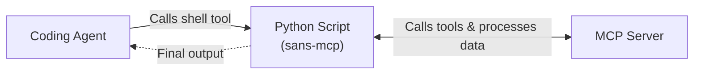

# sans-mcp

`sans-mcp` is a Python module that lets coding agents use Model Context Protocol (MCP) servers through ad-hoc Python scripts, without the need to configure an MCP client in the coding agent.

- **On-demand discovery:** The coding agent can discover tool descriptions on demand, without polluting the context before they are needed.
- **In-memory data processing:** The coding agent can process responses and chain multiple tool calls in a single Python script all in one go, without requiring an LLM round-trip for each step.
- **Zero configuration:** The coding agent connects directly to any MCP server from ad-hoc Python scripts, without configuring an MCP client or restarting the agent.
- **Stdio-to-HTTP proxy:** Converts stdio MCP servers to Streamable HTTP endpoints.
- **Single-file module with no dependencies:** Uses only the Python standard library.



## Usage

### 1. Discover Tools

Call `m.help()` to print tool signatures and documentation formatted as Python function signatures:

```python
import sans_mcp

with sans_mcp.connect("python3 tests/mock_server.py") as m:
    print(m.help())
    # Or inspect a specific tool:
    # print(m.help("list_items"))
```

From the command line, run:

```bash
# List all tools (stdio command or HTTP URL)
python3 -m sans_mcp help "python3 tests/mock_server.py"
python3 -m sans_mcp help http://127.0.0.1:8000/mcp

# Inspect a specific tool
python3 -m sans_mcp help "python3 tests/mock_server.py" list_items
```

Output:

```text
Server: dummy-stdio-server (1.2.3) — 4 tools
Usage: m.tools.<tool_name>(param=value, ...)

get_info()
    Get system info

get_item(*, item_id: str)
    Get item details by ID
    Args:
      item_id: Item identifier

greet_user(*, user_name: str)
    Greet a user by name
    Args:
      user_name: The user's name

list_items(*, category: str = None)
    List available items with optional category filter
    Args:
      category: Category filter
```

### 2. Call Tools from Python

Connect to an HTTP URL or `stdio` command and call tools on `m.tools` using keyword arguments. Tool calls return parsed Python objects (`dict`, `list`, `str`) directly:

```python
import sans_mcp

with sans_mcp.connect("python3 tests/mock_server.py") as m:
    items = m.tools.list_items(category="hardware")
    for item in items:
        info = m.tools.get_item(item_id=item["id"])
        print(f"{info['name']}: {info['status']}")
```

### 3. Stdio-to-HTTP Proxy

Run `python3 -m sans_mcp proxy` to expose a `stdio` MCP server as a Streamable HTTP endpoint (at `http://127.0.0.1:6270/mcp` by default):

```bash
# Expose a stdio MCP server over HTTP (customize address with --listen :PORT)
python3 -m sans_mcp proxy -- npx -y @playwright/mcp
```

To run the proxy in the background, a process runner such as [`runagent`](https://github.com/tsaarni/runagent/) can be used.

```python
import sans_mcp

with sans_mcp.connect("http://127.0.0.1:6270/mcp") as pw:
    pw.tools.browser_navigate(url="https://example.com")
    print(pw.tools.browser_snapshot())
```

## Installation

To make `sans_mcp` available across workspaces, install it into your user environment:

```bash
pip install --user --break-system-packages git+https://github.com/tsaarni/sans-mcp
```

Or download the single file directly into the project directory:

```bash
curl -O https://raw.githubusercontent.com/tsaarni/sans-mcp/main/sans_mcp.py
```


